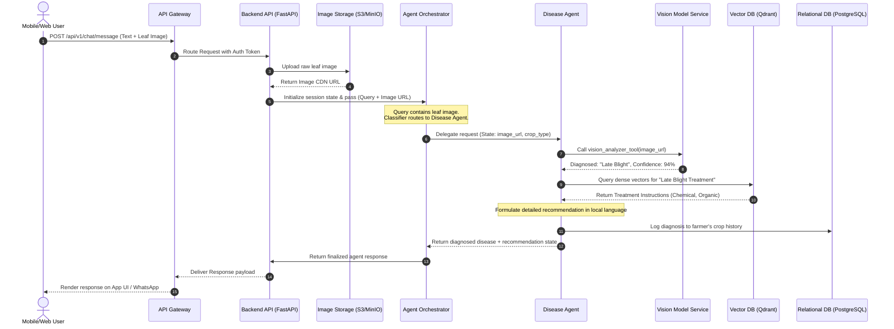
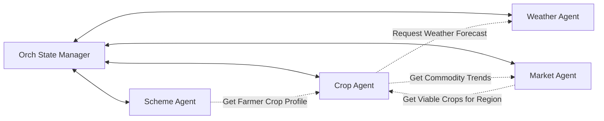

# Kisan Mitra AI Architecture Blueprint

This document details the architectural design for **Kisan Mitra AI**, a production-ready, multi-agent AI system designed to assist farmers. The system is architected for scalability, low latency, multi-lingual support, offline-first message queueing, and agentic collaboration.

---

## 1. High-Level Architecture

The architecture follows a modular, decoupled design composed of a client layer, API Gateway, orchestrator service, multi-agent execution framework, vector search engine, and transactional databases.

```mermaid
graph TD
    %% Clients
    subgraph Client Layer
        Web["Web Application (React/Next.js)"]
        Mobile["Mobile App (Flutter/React Native)"]
        SMS["SMS / WhatsApp Gateway (Twilio/Gupshup)"]
    end

    %% API Gateway & Auth
    subgraph Entry & Routing
        GW["API Gateway (Kong / Traefik)"]
        Auth["Auth Service (OAuth2 / JWT)"]
    end

    %% Orchestration
    subgraph Agent Core (LangGraph / State Engine)
        Orch["Agent Orchestrator (State Coordinator)"]
        State["Shared State / Memory (Redis)"]
    end

    %% Agent Pool
    subgraph Multi-Agent System
        CRA["Crop Recommendation Agent"]
        PDA["Plant Disease Diagnosis Agent"]
        WAA["Weather Alert Agent"]
        MPA["Market Price Analysis Agent"]
        GSA["Government Schemes Agent"]
    end

    %% Third-party APIs & External Systems
    subgraph External Integrations
        WeatherAPI["OpenWeather / IMD API"]
        MandiAPI["Agmarknet / Market API"]
        GovPortals["Gov Scheme Scraping / API"]
    end

    %% Storage & Search
    subgraph Data & Knowledge Base
        RDB["Primary Relational DB (PostgreSQL)"]
        VDB["Vector DB (Qdrant / pgvector)"]
        Cache["Cache & Queue (Redis / RabbitMQ)"]
    end

    %% Connections
    Web --> GW
    Mobile --> GW
    SMS --> GW
    GW --> Auth
    GW --> Orch
    Orch <--> State
    Orch <--> CRA
    Orch <--> PDA
    Orch <--> WAA
    Orch <--> MPA
    Orch <--> GSA

    %% Agent tools
    CRA --> WeatherAPI
    CRA --> RDB
    PDA --> VDB
    PDA --> RDB
    WAA --> WeatherAPI
    MPA --> MandiAPI
    GSA --> VDB
    
    %% DB links
    Orch --> RDB
    Orch --> Cache
```

### High-Level Layers
*   **Access Layer**: Provides entry points for Web, Mobile, and low-connectivity channels like WhatsApp/SMS (crucial for rural farmers).
*   **Security & Routing Layer**: API Gateway handles rate limiting, authentication, telemetry, and request routing.
*   **Agent Orchestration Engine**: Manages user session state, agent switching, and context propagation using a stateful routing model (e.g., LangGraph or custom state graph).
*   **Agent Layer**: Specialized, autonomous AI agents equipped with tools to execute specific tasks.
*   **Integration Layer**: External APIs for real-time market data, localized weather forecasts, and government scheme updates.
*   **Persistence & Knowledge Layer**: PostgreSQL (relational user, land, and crop records), Redis (session/state cache), and Qdrant/pgvector (RAG vector database for schemes and disease knowledge bases).

---

## 2. Low-Level Architecture

The multi-agent system uses a **Supervisor-Worker** or **Hierarchical State Graph** pattern. The Orchestrator delegates tasks to specialized sub-agents based on semantic routing.

```
                  ┌──────────────────────┐
                  │   User Request       │
                  └──────────┬───────────┘
                             ▼
               ┌───────────────────────────┐
               │    Query Classifier       │ (Semantic Router / LLM Classifier)
               └─────────────┬─────────────┘
                             │
         ┌───────────────────┼───────────────────┬───────────────────┐
         ▼                   ▼                   ▼                   ▼
┌────────────────┐  ┌────────────────┐  ┌────────────────┐  ┌────────────────┐
│ Crop Advisor   │  │ Disease Diagn. │  │ Weather Sentry │  │ Market Analyst │
│ Agent          │  │ Agent          │  │ Agent          │  │ Agent          │
└────────┬───────┘  └────────┬───────┘  └────────┬───────┘  └────────┬───────┘
         │                   │                   │                   │
         └───────────────────┼───────────────────┴───────────────────┘
                             ▼
               ┌───────────────────────────┐
               │   State Merger & Response │
               └─────────────┬─────────────┘
                             ▼
                  ┌──────────────────────┐
                  │ Output (Multi-Ling)  │
                  └──────────────────────┘
```

### Agent Specifications & Toolkits

#### A. Crop Recommendation Agent
*   **Goal**: Recommend optimal crops based on soil data, historical yields, and climate.
*   **State Inputs**: Soil N-P-K levels, pH value, rainfall trends, temperature, geographic coordinates.
*   **Tools**:
    *   `soil_analyzer_tool`: Retrieves soil profiles for a given region.
    *   `crop_yield_estimator`: Simple statistical model to project crop viability.
    *   `weather_history_retriever`: Fetch historical weather trends for the coordinates.

#### B. Plant Disease Diagnosis Agent
*   **Goal**: Diagnose plant health issues using leaf images and symptom descriptions.
*   **State Inputs**: Leaf image URL (saved in S3/MinIO), crop type, symptoms text.
*   **Tools**:
    *   `vision_analyzer_tool`: Invokes a fine-tuned vision model (e.g., ResNet/ViT or Gemini Vision) to output classification and confidence scores.
    *   `disease_knowledge_retriever`: Queries Vector DB (RAG) to find curative steps, organic remedies, and chemical solutions for the diagnosed disease.

#### C. Weather Alert Agent
*   **Goal**: Alert farmers about impending adverse weather and provide proactive farming actions (e.g., "Heavy rain tomorrow, delay pesticide spraying").
*   **State Inputs**: Farmer location, crop stage, current date.
*   **Tools**:
    *   `realtime_weather_tool`: Queries weather APIs for 7-day forecasts.
    *   `impact_advisory_engine`: Knowledge graph matching weather conditions with crop-specific vulnerabilities (e.g., frost vulnerability for tomatoes).

#### D. Market Price Analysis Agent
*   **Goal**: Analyze mandi rates, predict short-term price trends, and suggest optimal times to sell.
*   **State Inputs**: Selected commodity, region/state, max radius.
*   **Tools**:
    *   `mandi_price_scraper`: Fetches live government mandi prices.
    *   `price_trend_forecaster`: Runs a time-series model (or structured LLM evaluation) on historical prices.

#### E. Government Schemes Agent
*   **Goal**: Match farmers with state and central government welfare schemes based on demographics.
*   **State Inputs**: Farmer age, gender, category (SC/ST/General), landholding size (marginal, small, large), income, region.
*   **Tools**:
    *   `scheme_search_tool`: Dense vector search (RAG) over parsed government scheme PDFs.
    *   `eligibility_evaluator`: LLM tool that evaluates match criteria for filtered schemes.

---

## 3. Folder Structure

```
kisan-mitra-ai/
├── backend/
│   ├── src/
│   │   ├── agents/                   # Multi-agent definitions
│   │   │   ├── base_agent.py         # Abstract base agent class
│   │   │   ├── orchestrator.py       # LangGraph state coordinator
│   │   │   ├── crop_agent.py
│   │   │   ├── disease_agent.py
│   │   │   ├── weather_agent.py
│   │   │   ├── market_agent.py
│   │   │   └── scheme_agent.py
│   │   ├── tools/                    # Reusable agent toolsets
│   │   │   ├── weather_tools.py
│   │   │   ├── market_tools.py
│   │   │   ├── vector_tools.py
│   │   │   └── vision_tools.py
│   │   ├── models/                   # DB Models (SQLAlchemy/Tortoise)
│   │   │   ├── user.py
│   │   │   ├── crop.py
│   │   │   ├── disease.py
│   │   │   └── scheme.py
│   │   ├── services/                 # Business logic / integration APIs
│   │   │   ├── translation.py        # Localized language translator
│   │   │   ├── storage.py            # S3 Image upload management
│   │   │   └── notification.py       # SMS / WhatsApp push engine
│   │   ├── config/                   # Global configuration
│   │   │   ├── database.py
│   │   │   ├── settings.py
│   │   │   └── prompts.py            # System prompts for agents
│   │   ├── api/                      # REST endpoints & WebSockets
│   │   │   ├── v1/
│   │   │   │   ├── auth.py
│   │   │   │   ├── chat.py
│   │   │   │   └── reports.py
│   │   │   └── router.py
│   │   └── main.py                   # App entrypoint (FastAPI)
├── database/
│   ├── migrations/                   # Alembic migration scripts
│   ├── seeds/                        # Seed data (soil, commodities)
│   └── vector_store/
│       └── ingest_schemes.py         # Script to parse & index gov schemes
├── security/                         # IAM, rate limits, network policies
├── tests/
│   ├── unit/
│   └── integration/
├── frontend/                         # User Interface
├── package.json
└── tsconfig.json
```

---

## 4. Request Flow Diagram

This diagram demonstrates how a request containing an uploaded image of a diseased crop is processed.



---

## 5. Agent Communication Diagram

Agents can query other agents using peer-to-peer message passing via the central State Manager.



*   **Crop-to-Weather Correlation**: Before recommending a crop, the `Crop Recommendation Agent` requests multi-month precipitation outlooks from the `Weather Agent`.
*   **Market-to-Crop Correlation**: When recommending crops, the `Crop Recommendation Agent` consults the `Market Agent` to avoid recommending crops currently in oversupply or facing severe price drops.
*   **Scheme Eligibility**: The `Government Scheme Agent` reads the crop recommendations and farmer profile from the shared state to match crop-specific insurance or subsidies (e.g., PM Fasal Bima Yojana).

---

## 6. Database Design

### Relational Database Schema (PostgreSQL)

```sql
-- Core user entity
CREATE TABLE users (
    id UUID PRIMARY KEY DEFAULT gen_random_uuid(),
    phone_number VARCHAR(15) UNIQUE NOT NULL,
    full_name VARCHAR(100),
    preferred_language VARCHAR(10) DEFAULT 'en',
    created_at TIMESTAMP WITH TIME ZONE DEFAULT CURRENT_TIMESTAMP
);

-- Farmer demographic & property details
CREATE TABLE farmer_profiles (
    id UUID PRIMARY KEY DEFAULT gen_random_uuid(),
    user_id UUID REFERENCES users(id) ON DELETE CASCADE,
    state VARCHAR(50) NOT NULL,
    district VARCHAR(50) NOT NULL,
    village VARCHAR(100),
    land_size_hectares DECIMAL(5,2),
    soil_type VARCHAR(50),
    irrigation_source VARCHAR(50),
    updated_at TIMESTAMP WITH TIME ZONE DEFAULT CURRENT_TIMESTAMP
);

-- Diagnostic logs
CREATE TABLE disease_diagnoses (
    id UUID PRIMARY KEY DEFAULT gen_random_uuid(),
    user_id UUID REFERENCES users(id),
    image_url TEXT NOT NULL,
    crop_detected VARCHAR(50),
    diagnosis VARCHAR(100) NOT NULL,
    confidence DECIMAL(4,2),
    remedy_suggested TEXT,
    created_at TIMESTAMP WITH TIME ZONE DEFAULT CURRENT_TIMESTAMP
);

-- Crop recommendation log
CREATE TABLE crop_recommendations (
    id UUID PRIMARY KEY DEFAULT gen_random_uuid(),
    user_id UUID REFERENCES users(id),
    recommended_crop VARCHAR(50) NOT NULL,
    confidence_score DECIMAL(4,2),
    parameters_used JSONB, -- Stores N-P-K, pH, temperature snapshot
    created_at TIMESTAMP WITH TIME ZONE DEFAULT CURRENT_TIMESTAMP
);
```

### Vector Database Collections (Qdrant / pgvector)

1.  **`government_schemes` Collection**
    *   **Payload Schema**:
        ```json
        {
          "scheme_name": "PM-KISAN",
          "benefits": "₹6,000/year in three equal installments",
          "eligibility": {
            "max_land_size": 2.0,
            "required_documents": ["Aadhaar", "Land Records"]
          },
          "source_url": "https://pmkisan.gov.in/"
        }
        ```
    *   **Vector**: 1536-dim (from `text-embedding-3-small` or multi-lingual sentence-transformer).

2.  **`crop_disease_knowledge` Collection**
    *   **Payload Schema**:
        ```json
        {
          "disease_name": "Tomato Late Blight",
          "pathogen": "Phytophthora infestans",
          "organic_control": "Apply copper-based fungicides or biological agents like Bacillus subtilis.",
          "chemical_control": "Use Metalaxyl or Mancozeb sprays.",
          "preventive_measures": "Ensure crop rotation, wide spacing, and drip irrigation."
        }
        ```
    *   **Vector**: 1536-dim.

---

## 7. Explanation of Every Layer

### 1. Client / Delivery Layer
*   **Web & Mobile Apps**: Native interactive experience supporting audio recording (voice-to-text queries) and camera operations for uploading disease images.
*   **SMS & WhatsApp Integration**: Utilizes lightweight, stateless webhook receivers. Translates text/voice messages to English backend inputs and translates outputs back to regional languages (Hindi, Telugu, Tamil, Marathi, etc.).

### 2. API Gateway & Authentication
*   **Ingress Routing**: Validates JWTs, intercepts malicious traffic, rate-limits users based on phone numbers, and manages CORS headers.
*   **Session Manager**: Maps API requests to existing user conversations in Redis.

### 3. Orchestration & State Layer (LangGraph)
*   **Routing State**: Stores current state parameters (e.g., location, selected crop, query intention).
*   **Semantic Router**: Evaluates user queries and routes them to the correct agent. If a farmer asks "My tomato leaves have yellow spots and what is the market rate?", the router invokes the `Disease Agent` followed by the `Market Agent`.

### 4. Agent Engine
*   **Specialized LLM Prompts**: Every agent uses a system prompt optimized for agricultural domains and formatted output specifications (JSON).
*   **Dynamic Tool Calling**: Agents decide when to pull live information (e.g. current mandi price) versus querying the Vector database.

### 5. Translation & Localization Service
*   **Real-time Translators**: Uses highly optimized models (e.g., Google Translate API or open-source Bhashini / IndicTrans2) to provide low-latency translations for farmers who communicate in regional vernaculars.

### 6. Persistence & Vector Layer
*   **PostgreSQL**: Keeps track of farmer data, soil records, and diagnostic history, enabling long-term personalization.
*   **Vector Database**: Serves as the high-speed semantic retrieval index for unstructured knowledge assets like government policy brochures, crop manuals, and scientific plant research.
